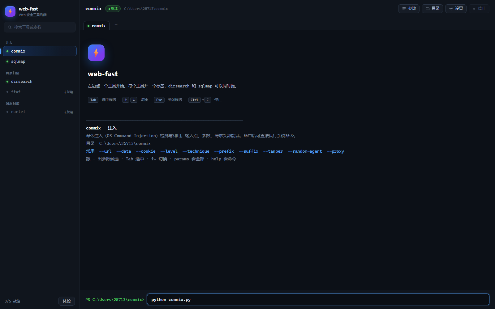
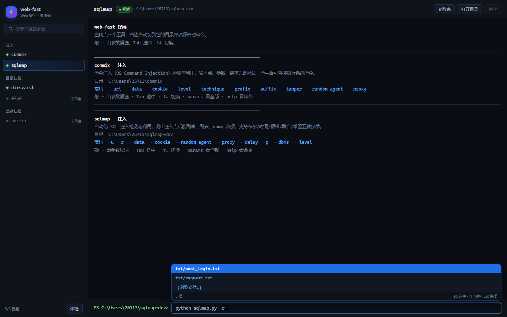

# Web-Fast · BaBaTa

## 为什么会有这个软件

**纯粹因为作者太懒了。**

- 不想背参数，`--level` `--risk` `--tamper` `--technique` 这些鬼东西每次都要查
- 不想敲参数，一个 `-u` 加个 URL 都要复制粘贴三次
- 不想每次先 `cd` 到工具目录，再敲 `python sqlmap.py`
- 不想为了跑一个 dirsearch 去记 `-w` 后面该跟哪个字典
- 不想看到几百行 `[####]` 进度条把结果挤到看不见的地方

所以花了三十倍的时间，写了个工具，来省掉「敲参数」这点时间。

**很划算——如果你不计算写它的时间的话。**

顺便把配色、候选弹窗、多标签、查找也都做了，反正已经懒到这个地步了，干脆懒到底。

---

> [!WARNING]
> ## 现版本勿用
>
> **当前版本存在严重问题，不建议在任何真实场景使用。**
> 它是边用边改出来的半成品，进度条过滤只覆盖一个工具、输出解析靠猜、进程控制不完整。
> 想跑扫描请直接用原工具，Web-Fast 目前只能当作界面原型看。
>
> 具体问题清单见文末 [已知问题与限制](#已知问题与限制)。

> [!IMPORTANT]
> ## 无任何 AI 接入
>
> 本项目**不包含任何 AI / 大模型 / 云端接口**。
>
> - 没有 OpenAI / Anthropic / DeepSeek 之类的 API 调用
> - 没有联网请求（除工具自己跑的那部分）
> - 没有遥测、没有埋点、没有崩溃上报
> - 没有账号体系，不上传任何数据
>
> 全部逻辑在本机跑：Python 标准库 + 本地 HTTP 服务 + WebView2 渲染。
> 配置、输出、历史记录都只写在本地目录里。

> [!NOTE]
> ## 完全由 AI 打造 · 完全离线可用
>
> **开发方式：全部由 AI 编码代理生成。**
> 没有一行是手写的。需求由人提出，代码、界面、文档、测试由 AI 产出，
> 每一步都跑真实环境验证——包括打包成 exe、在另一台机器上试运行。
>
> **运行方式：不联网。**
>
> - 本地服务只绑定 `127.0.0.1`，不对外暴露
> - 运行时不请求任何外部接口、不查版本、不回传数据
> - 断网、内网、隔离环境、比赛现场都能直接跑
> - 唯一的外部需求是提前装好 Python 和工具本体（都是本地文件）
>
> 比赛场景的完整离线清单：
>
> ```text
> 需要准备的（提前放在本机）：
>   ✓ Python 3.9+
>   ✓ WebView2 运行时（Win11 自带）
>   ✓ sqlmap / dirsearch / commix 等待用工具
>   ✓ 本项目的 exe 或源码
>
> 不需要的（全程用不上）：
>   ✗ 网络连接
>   ✗ 账号登录
>   ✗ 任何在线服务
>   ✗ 授权码 / 订阅
> ```

> 把 sqlmap、commix、dirsearch、ffuf、nuclei 这些命令行工具收进一个终端窗口里。
> 不用 cd、不用敲 `python xxx.py`、不用背参数。


---

## 它解决什么问题

| 原来的样子 | 用 Web-Fast |
|---|---|
| 每次打开都得先 `cd` 到工具目录 | 点一下工具名，自动切目录 |
| 得记住入口是 `sqlmap.py` 还是 `dirsearch.py` | 自动填好 `python sqlmap.py `，光标停在后面 |
| 参数靠背，`--level`、`--tamper` 各是什么全靠猜 | 敲 `-` 出候选，每个参数带中文说明和示例 |
| 打错一个字母白跑十分钟 | 参数名校验 + 候选补全 |
| 输出刷屏、进度条几百行、结果和日志糊成一团 | 进度折叠成一行、结果按状态码上色、`Ctrl+F` 搜索 |
| 想同时跑两个扫描得开两个终端 | 多标签，一个工具一个标签 |

---

## 特性

### 参数候选（inline，不是弹窗）

在输入框里敲 `-`，候选条直接浮在输入框上方：

```text
┌────────────────────────────────────────────────────┐
│ ▸ -r            从文件加载 HTTP 请求                │
│   --risk        风险等级（1-3）                     │
│   --tamper      混淆脚本，绕过 WAF                  │
│   -u            目标 URL                            │
│   3 项  Tab 选中 · ↑↓ 切换 · Esc 关闭               │
├────────────────────────────────────────────────────┤
│ PS C:\tools\sqlmap-dev> python sqlmap.py -          │
└────────────────────────────────────────────────────┘
```

- `Tab` 选中，`↑↓` 切换，`Esc` 关掉
- 输入 `-l` 会收到 `--level`，`-r`、`-u` 排在最前

### 值候选

参数后面按空格，自动弹该参数的可选值：

| 参数 | 弹出什么 |
|---|---|
| `-r` | txt 目录下的文件列表 + 「浏览文件…」 |
| `--tamper` | 84 个 tamper 脚本 |
| `-e` | 26 个扩展名（php/html/asp/zip…） |
| `--exclude-status` | 常见状态码列表 |
| `--technique` | B/E/U/S/T/Q/BEUST |

**多值参数支持逗号续选**：

```text
-e php,      → 候选条再弹一次
-e php,html,
-e php,html,js
```

选过的不会重复追加。

### 引号按参数决定

不是所有参数都该加引号。每个参数在 TOML 里配了 `quote` 规则：

```toml
[[param]]
name = "-u"
quote = "1"        # 强制加引号 → -u "http://..."

[[param]]
name = "-e"
quote = "0"        # 不加引号   → -e php,html

[[param]]
name = "--level"
# 不写 = 自动判断：路径类加引号，其余看值里有没有空格
```

### 输出按状态码上色

```text
[23:20:59] 403 -   321B - /cgi-bin/          ← 4xx 灰蓝
[23:21:10] 200 -     2B - /health            ← 2xx 绿色
[23:21:12] 200 -     2K - /index.php
[23:21:28] 301 -     0B - /admin  →  /admin/ ← 3xx 橙色
[23:21:41] 200 -     6K - /www.zip           ← 大小黄色、路径蓝色
[23:22:01] 500 -     3K - /api/debug         ← 5xx 红色
```

时间戳青色、状态码按首位分色、大小黄色、路径蓝色。同时解析 ANSI 转义序列，工具自己输出颜色也能渲染。

### 进度条折叠，不刷屏

dirsearch 在管道模式下的进度帧没有任何分隔符，几百帧会连成一整行。Web-Fast 识别这种帧序列，把整串折叠成一条状态：

```text
[● dirsearch  57%  5561/9631  ×]
```

进度显示在标签页标题上，终端里只留结果行。

### 多标签

左边点一个工具 = 开一个标签，每个标签独立：

- 自己的工作目录
- 自己的输入内容
- 自己的输出流
- 自己的运行状态

dirsearch 扫着，切到另一个标签跑 sqlmap，互不干扰。

### Ctrl+F 查找

```text
🔍 [www.zip                    ]  1/1   ↑  ↓  ×
```

- 输入即高亮，所有命中行标黄底
- `Enter` 下一个 / `Shift+Enter` 上一个
- `Esc` 关闭
- 只搜当前标签

### 每个工具独立设置

点「设置」→ 左边选工具 → 右边改这个工具的参数路径：

```text
工具根目录  root
[C:\tools\sqlmap-dev                    ]  [浏览…]
[打开]

请求文件目录  txt_dir
[txt                                       ]  [浏览…]
✓ 目录存在

输出目录  output_dir
[output                                    ]  [浏览…]
✓ 目录存在
```

- 「浏览…」弹系统文件夹选择器
- 「打开」在资源管理器里打开
- 子目录填相对路径（如 `txt`）会跟着工具根目录走
- 「自动扫描本机」自动找常见安装位置

### 路径换电脑能用

配置里的 `C:/Users/旧用户名/...` 会自动映射到当前用户。也可以设环境变量临时覆盖：`WEBFAST_SQLMAP`。

---

## 快速开始

### 环境

- Windows 10 / 11
- Python 3.9+
- WebView2 运行时（Win11 自带；Win10 大多数有，没有就装一次 [WebView2](https://developer.microsoft.com/microsoft-edge/webview2/)）

### 安装

```powershell
git clone https://github.com/<your-name>/web-fast.git
cd web-fast

python -m pip install -r requirements.txt
```

`requirements.txt` 只有一行（`pywebview`），其余全用标准库。

### 准备工具本体

Web-Fast **不附带**任何工具，需要自己下载：

| 工具 | 下载 |
|---|---|
| sqlmap | https://github.com/sqlmapproject/sqlmap |
| commix | https://github.com/commixproject/commix |
| dirsearch | https://github.com/maurosoria/dirsearch |
| ffuf | https://github.com/ffuf/ffuf |
| nuclei | https://github.com/projectdiscovery/nuclei |

放哪都行，Web-Fast 只要知道路径。

### 运行

```powershell
# 桌面应用（独立窗口，推荐）
python webfast.py app

# 浏览器模式
python webfast.py web

# 指定端口 / 不自动开浏览器
python webfast.py web -p 9000 --no-browser
```

首次打开点「设置」→「自动扫描本机」，或者手动填工具根目录。

### 命令行也能用

```powershell
python webfast.py list                    # 列出所有工具
python webfast.py info sqlmap             # 看 sqlmap 的参数表
python webfast.py search tamper           # 跨工具搜参数
python webfast.py run sqlmap -u http://t/ --batch
python webfast.py discover                # 扫本机安装的工具
python webfast.py doctor                  # 自检
```

---

## 界面





### 快捷键

| 按键 | 作用 |
|---|---|
| `-` | 弹参数候选 |
| 空格 | 参数有候选值时弹值候选 |
| `Tab` | 选中当前候选 |
| `↑ ↓` | 候选间切换，无候选时翻历史 |
| `Esc` | 关闭候选 / 关闭查找 |
| `Enter` | 执行 / 运行中发送到工具 stdin |
| `Ctrl+C` | 结束当前命令 |
| `Ctrl+F` | 在输出里查找 |
| `Ctrl+空格` | 强制弹候选 |

---

## 添加自己的工具

新工具的接入只需要一个 TOML 文件，不用改代码。

```toml
# tools/mytool.toml
id = "mytool"
name = "mytool"
category = "侦察"
summary = "一句话说明"
cwd = "third_party/mytool"          # 相对项目根，或绝对路径
runner = "python"                    # python | module | direct
entry = "mytool.py"
requires = ["requests"]

[[param]]
name = "-u"
type = "string"
label = "目标地址"
desc = "要测试的 URL"
example = "-u http://target/"
quote = "1"

[[param]]
name = "-w"
type = "file"
label = "字典"
desc = "要用的字典文件"
source = "glob:" + D + "{dict_dir}/*.txt"
setting = "dict_dir"

[[setting]]
key = "dict_dir"
label = "字典目录"
default = "db"
type = "dir"

[[template]]
name = "快速扫描"
cmd = "-u " + D + "{url} -w " + D + "{dict_dir}/common.txt"
```

字段说明：

| 字段 | 作用 |
|---|---|
| `type` | `bool` / `string` / `file` / `dir` / `positional` |
| `quote` | `"1"` 强制加引号、`"0"` 不加、不写自动判断 |
| `source` | 候选来源：`list:a\|b\|c` / `glob:路径` / `dir:路径` |
| `source_multi` | `true` 时支持逗号续选 |
| `repeat` | `true` 时参数可重复出现 |

放好 TOML，重启应用，左侧就多一个工具。

---

## 打包成 exe

```powershell
python -m PyInstaller --noconfirm --onedir --windowed --name WebFast ^
  --icon "web\icon.ico" ^
  --add-data "web;web" ^
  --add-data "tools;tools" ^
  --add-data "settings.toml;." ^
  --collect-all webview ^
  --hidden-import clr ^
  webfast_app.py
```

产物在 `dist/WebFast/`，整个文件夹拷走就能用，目标机器不需要装 Python。

| 参数 | 作用 |
|---|---|
| `--windowed` | 不弹控制台黑框 |
| `--onedir` | 目录版，启动快（单文件版每次要解压） |
| `--add-data` | 把 `web/`、`tools/`、配置打进包 |
| `--collect-all webview` | pywebview 的 JS/DLL 资源全收 |
| `--hidden-import clr` | pythonnet，WebView2 靠它 |

### 打包版的路径分两层

```python
APP_ROOT  = _MEIPASS 或项目根    # 只读资源（web/、tools/）
USER_ROOT = exe 所在目录          # 可写（local_paths.toml、output/）
```

打包后 `sys.executable` 指向 exe 自己，不能拿它跑工具脚本，所以单独做了解析：

```python
def python_exe() -> str:
    if not _is_frozen():
        return sys.executable          # 源码模式
    for name in ("python.exe", "python3.exe", "python"):
        found = shutil.which(name)     # 打包后找系统 Python
        if found:
            return found
    return shutil.which("py.exe") or "python"
```

---

## 项目结构

```text
web-fast/
├── webfast/
│   ├── registry.py      工具与参数的模型、路径解析
│   ├── launcher.py      进程启动、输出泵、进度帧识别
│   ├── server.py        HTTP + SSE 服务
│   ├── resolve.py       候选值解析（文件/目录/枚举）
│   ├── discover.py      扫本机安装的工具
│   ├── app.py           桌面窗口（pywebview + DWM 深色标题栏）
│   ├── gui.py           Tkinter 版（备用）
│   └── cli.py           命令行接口
├── web/                 前端（无构建，原生 HTML/CSS/JS）
│   ├── index.html
│   ├── app.js
│   └── style.css
├── tools/               工具描述（TOML，一个工具一个文件）
├── tests/               测试
├── settings.toml        全局配置
└── webfast.py           主入口
```

后端只用标准库：`http.server` + `ThreadingHTTPServer` + SSE，没有 Flask/FastAPI。前端没有打包步骤，改完刷新就生效。

---

## 测试

```powershell
python -m pytest tests/ -v

# 或者单独跑
python tests/test_param.py
python tests/test_web.py
python tests/test_progress.py
```

覆盖：参数解析、候选生成、输出分类、SSE 流、设置读写。

---

## 已知问题与限制

> **当前版本 v1.0.6 存在下列问题，严重程度足以影响正常使用。**
> 这个项目是边用边改出来的，不是一次写完的产品。下面列的每一条都真实存在，跑起来大概率遇到。
> 其中「输出处理」和「执行与控制」两节的问题会直接影响扫描结果的可信度。
> 遇到对不上的现象，先来这里核对，再判断是新问题还是已知问题。

### 一、输出处理

| 问题 | 表现 | 原因 | 状态 |
|---|---|---|---|
| 进度条只认 dirsearch 的格式 | 别的工具进度条还会刷屏 | 正则写死 `[###] NN% N/N N/s job:N/N errors:N` | 未解决 |
| 颜色是按内容猜的，不是工具原色 | 和直接在终端跑颜色不完全一致 | 管道模式下工具不输出 ANSI，靠状态码正则上色 | 设计取舍 |
| 输出超过 5000 行会丢最旧的 | 长时间跑看不到开头 | 前端限制 DOM 节点数，防内存爆 | 设计取舍 |
| 没有导出 | 不能把输出存成文件 | 未实现 | 待做 |
| 没有时间戳 | 输出里看不到每行产生的时刻 | 未给每行加标记 | 待做 |

**最典型的一条**：dirsearch 之外的进度条（pip 的下载条、curl 的 `\r` 进度、sqlmap 的连续 `[INFO]`）目前都没有专门处理。

### 二、执行与控制

| 问题 | 表现 | 原因 |
|---|---|---|
| Ctrl+C 不是真信号 | 某些工具来不及写日志或清理临时文件 | 用 `taskkill /T /F` 杀进程树，不是发 SIGINT |
| stdin 有延迟 | sqlmap 交互式 shell 里敲字有 100ms 级延迟 | 走 HTTP POST 不是 WebSocket |
| 打包版依赖系统 Python | 目标机没装 Python 就起不来工具 | 打包版用 `shutil.which("python")` 找解释器 |
| 工具超时不会自动杀 | 卡死的工具要手动点停止 | 没有 watchdog |

### 三、界面

| 问题 | 表现 |
|---|---|
| 只支持 Windows | 依赖 WebView2 和 `taskkill`，Linux / macOS 跑不了 |
| 多标签不持久化 | 关窗口全部丢失，重开是新的 |
| 查找只搜当前标签 | 不能跨标签搜索 |
| 缩放不完美 | 系统 125% / 150% 缩放下细线可能有半像素模糊 |
| 输入框超长时要横向拖 | 已修「一打字就跳回光标」，但查看前面内容仍需拖动 |
| 没有主题切换 | 只有深色 |

### 四、工具支持

| 问题 | 说明 |
|---|---|
| `ffuf` / `nuclei` 没实测过 | 只写了 TOML 描述，本机没装这两个工具，没跑过 |
| 参数表是静态的 | 工具更新参数后要手动改 TOML，不会自动同步 |
| 加新工具要手写 TOML | 没有图形化编辑器 |
| 只有 5 个工具的描述 | sqlmap / commix / dirsearch / ffuf / nuclei |

### 五、依赖与部署

| 问题 | 说明 |
|---|---|
| 不附带任何工具 | 工具本体要自己下载，Web-Fast 只是外壳 |
| Python 工具需要系统 Python | 打包的 exe 内嵌的 Python 不能用（会被当成 WebFast.exe 自己） |
| WebView2 要单独装 | Win10 老版本可能没有，需要手动装一次 |
| 只监听 127.0.0.1 | 不能远程访问，也不能给局域网其他机器用 |
| 没有认证 | 本地单用户设计，多人共用一台机器时配置会互相覆盖 |

### 六、没做的

- 自动更新
- 插件系统
- 输出导出 / 报告生成
- 历史记录界面（数据存在 `output/history.jsonl`，但没有界面看）
- 命令行管道输入（`echo xxx | webfast run`）
- 工具版本检测（不会提示你 sqlmap 该升级了）
- 国际化

### 七、怎么判断是新问题还是已知问题

```text
1. 对照上面七节，命中就是已知问题
2. 没命中，先跑自检：
   python webfast.py doctor
3. 自检正常但行为不对，收集这些再提问题：
   - 系统版本（winver）
   - Python 版本（python -V）
   - 触发的命令原文
   - 当时的输出（截图或复制）
   - 浏览器控制台报错（F12）
```

### 八、版本策略

```text
v1.0.x   当前，功能补齐阶段，上面问题陆续修
v1.1.0   目标：通用进度条识别（上 PTY）、输出导出
v2.0.0   目标：跨平台（去掉 Windows 专属依赖）
```

**没有承诺什么时候修完。** 这是个自用工具，用到哪里改到哪里。

---

## 致谢

工具本身来自这些项目：

- [sqlmap](https://github.com/sqlmapproject/sqlmap)
- [commix](https://github.com/commixproject/commix)
- [dirsearch](https://github.com/maurosoria/dirsearch)
- [ffuf](https://github.com/ffuf/ffuf)
- [nuclei](https://github.com/projectdiscovery/nuclei)

界面风格参考了 VS Code 的深色主题和 CyberChef 的配色。

---

## 作者

**parrot**

反馈或改进建议：2571308976@qq.com

## License

MIT
